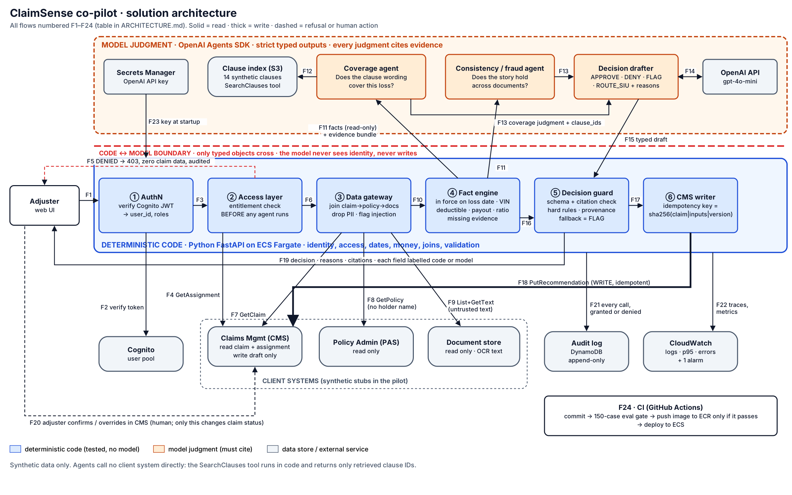

# Solution architecture

Source: [`diagrams/architecture.svg`](diagrams/architecture.svg), drawn by [`scripts/draw_architecture.py`](../scripts/draw_architecture.py).

**The boundary in one line:** blue boxes are ordinary tested Python and decide who, when and how much. Orange boxes are the model and decide what the words mean. Only typed objects cross the red line. The model never sees who the user is, never calls a client system and never writes anything.

## Every data flow

| # | From → To | What moves | Side | Read/Write |
|---|---|---|---|---|
| F1 | Adjuster → AuthN | `GET /claims/{id}/decision` with bearer token | code | R |
| F2 | AuthN → Cognito | verify token signature (JWKS) | code | R |
| F3 | AuthN → Access layer | `user_id`, `roles` from the verified token | code | — |
| F4 | Access layer → CMS | `GetAssignment(claim_id)`: who may see this claim | code | R |
| F5 | Access layer → Adjuster | **denied:** 403, zero claim data, audit record written | code | — |
| F6 | Access layer → Data gateway | granted `claim_id` | code | — |
| F7 | Data gateway → CMS | `GetClaim` | code | R |
| F8 | Data gateway → PAS | `GetPolicy` (holder name removed) | code | R |
| F9 | Data gateway → Document store | `ListDocuments`, `GetDocumentText` (text marked untrusted, scanned for injection) | code | R |
| F10 | Data gateway → Fact engine | typed `ClaimRecord`, `PolicyRecord`, `DocumentText[]` | code | — |
| F11 | Fact engine → agents | facts (read-only) + evidence bundle. **Crosses the boundary** | code → model | — |
| F12 | Coverage agent ↔ clause index | `SearchClauses` tool. The tool runs in code and returns clause IDs + text | model ↔ code | R |
| F13 | Coverage / consistency agents → drafter | judgments, each with citations | model | — |
| F14 | Agents ↔ OpenAI API | prompts out, typed outputs back | model | — |
| F15 | Drafter → Decision guard | typed draft decision. **Crosses the boundary** | model → code | — |
| F16 | Fact engine → Decision guard | facts, to merge in and check against the draft | code | — |
| F17 | Decision guard → CMS writer | valid `Recommendation` | code | — |
| F18 | CMS writer → CMS | `PutRecommendation`. **The only write to a client system**, idempotent | code | **W** |
| F19 | Decision guard → Adjuster | decision, reasons, citations, each field labelled `code` or `model` | code | — |
| F20 | Adjuster → CMS | confirm or override in the CMS's own UI. The only thing that changes claim status | human | **W** |
| F21 | Access layer, gateway, writer → Audit log | one record per call, granted or denied: user, action, resource | code | **W** (append-only) |
| F22 | Service → CloudWatch | logs, error rate, call volume, p95 latency, one alarm | code | W |
| F23 | Secrets Manager → service | OpenAI key at startup. Never in code, a prompt or a log | code | R |
| F24 | CI → ECR → ECS | 150-case eval gate. The image is pushed only if the gate passes | code | W |

## What sits on which side, and why

| Done in code (blue) | Why not the model |
|---|---|
| Identity and entitlement (F2–F5) | A model can be talked out of a rule. A failing `if` can't. Brief constraint 1. |
| Policy in force on the loss date | CLM-2024-2822: the status says "Active", the dates say no. A date comparison is exact. |
| VIN match claim ↔ policy | Exact string comparison. |
| Deductible, payout, repair/ACV ratio | Money must be reproducible to the cent and auditable. |
| Missing evidence (OCR pending) | A count, not an opinion. Forces FLAG. |
| Final guard: schema, cited clauses were retrieved, no APPROVE with missing evidence or red flags | The last line of defence has to be deterministic. |
| Idempotent write, audit | Retries and audit can't depend on wording. |

| Done by the model (orange) | Why not code |
|---|---|
| Does this clause's wording cover this loss? | Coverage depends on wording (brief §2). A pothole is a "collision" only because DEF-1 says so. |
| Does the story hold across documents? | CLM-2024-1873: the FNOL says "alone", the EMS note says a passenger left. No rule table finds that. |
| Drafting reasons an adjuster can check | Language. |

**Deterministic fallback.** If the model times out or returns something the guard rejects, the guard returns `FLAG` with `provenance=code` and the reason. The adjuster can always tell a model verdict from a fallback, which brief Milestone 3 item 5 requires.

## Stack

| Need (brief §4) | Choice | Why this, not the alternative |
|---|---|---|
| Typed, verifiable model output | OpenAI Agents SDK, strict output types (Pydantic) | Cohort standard. The same Pydantic models are the contracts. |
| Retrieval with source attribution | Clause corpus, embeddings index stored in S3, `SearchClauses` tool | 14 clauses don't justify a vector database service. Revisit at hundreds of policy forms. |
| Controlled access to client systems | Our own FastAPI service; Cognito JWT; entitlement before agents | One governed door, as in the class's MCP pattern. A full MCP server is deferred: 3 systems, request/reply, 5 weeks (DECISIONS D-008). |
| Portable execution | Docker → ECR → ECS Fargate | Single-command local start with docker compose; same image in AWS. |
| Change control | GitHub Actions, eval gate blocks the ECR push | Acceptance criteria become CI thresholds. |
| Hosting, observability, recovery | AWS: ECS, DynamoDB (audit), S3, CloudWatch, Secrets Manager | Cohort standard. A real insurer on Azure would flip this (see below). |

**When the answer flips:** if the client runs on Microsoft/Entra, use Azure and Entra ID, with the same code/model split. Stack follows the client. Integration is point-to-point through the one access layer. An iPaaS or event mesh only becomes worth it when intake turns event-driven after the pilot.

## Alternatives we rejected

| Alternative | Why rejected |
|---|---|
| Extend the rule table | Can't read clause wording or check whether a story is consistent. Brief §2 rules it out. |
| One big agent with direct database access | Access control would live in a prompt. That is the "Weak" band for area D. |
| Model computes payout "with a calculator tool" | Still lets the model choose inputs. Code computes, the model only sees the result. |
| Co-pilot writes `claim_status` | Removes the licensed adjuster from the loop. Out of scope by charter. |
| Managed vector DB (OpenSearch) | Cost and setup out of proportion to 14 clauses. |
